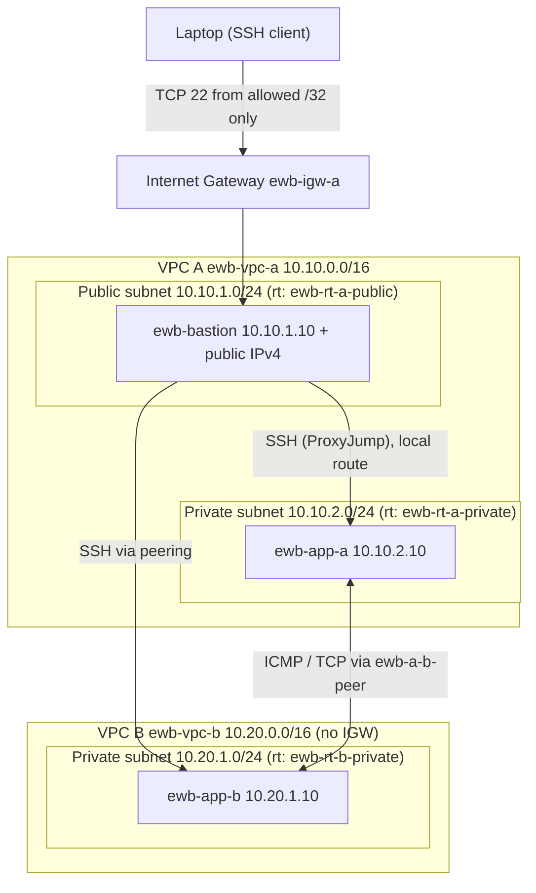

# Architecture

## Route tables
| Table | Destination | Target |
|---|---|---|
| ewb-rt-a-public | 10.10.0.0/16 | local |
| | 0.0.0.0/0 | Internet Gateway |
| | 10.20.0.0/16 | peering connection |
| ewb-rt-a-private | 10.10.0.0/16 | local |
| | 10.20.0.0/16 | peering connection |
| ewb-rt-b-private | 10.20.0.0/16 | local |
| | 10.10.0.0/16 | peering connection |

## Inbound security rules (as defined in Terraform)
| Security group | Rule | Source |
|---|---|---|
| ewb-sg-bastion | TCP 22 | operator public IPv4 /32 (variable) |
| ewb-sg-app-a | TCP 22 | 10.10.1.10/32 (bastion) |
| ewb-sg-app-a | ICMP echo request | 10.20.1.10/32 (App-B) |
| ewb-sg-app-b | TCP 22 | 10.10.1.10/32 (bastion) |
| ewb-sg-app-b | ICMP echo request | 10.10.2.10/32 (App-A) |
| ewb-sg-app-b | TCP 22 from 10.10.2.10/32 (App-A) | **Optional, test-only**, off by default (`enable_app_b_ssh_from_app_a_test`); exists manually in the live lab |

Peering is non-transitive and gives VPC B no internet access through VPC A. Security groups are stateful; default network ACLs are used.
